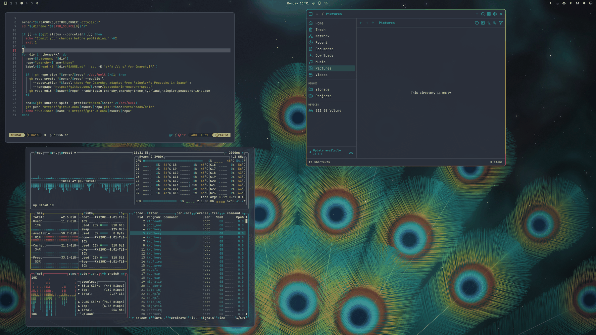

# Peacocks In Space for Omarchy

An Omarchy 4 theme adapted from Peacocks in Space by [Rainglow](https://github.com/rainglow/vscode).

Variants: **Peacocks In Space** · [Peacocks In Space Contrast](https://github.com/ottojimb/omarchy-peacocks-in-space-contrast-theme) · [Peacocks In Space Light](https://github.com/ottojimb/omarchy-peacocks-in-space-light-theme)



## Install

```bash
omarchy theme install https://github.com/ottojimb/omarchy-peacocks-in-space-theme
```

For frosted glass, pick Glassy Windows and Glassy Bar in the Omarchy menu, under Appearance.

## What's included

- Peacock-feather gradient on window borders, carried to notifications, the launcher and the lock screen
- Eight-hue terminal palette built from Rainglow's accents
- Three 4K wallpapers drawn from the palette: a peacock eye, a fanned plumage and a nebula

Rainglow's syntax colors for Neovim and the Rainglow VS Code theme come with the
[source repository](https://github.com/ottojimb/peacocks-in-omarchy-space)'s `install.sh`.

## Credits

Palette: Peacocks in Space by Dayle Rees, from Rainglow (MIT). This repository is generated
from [peacocks-in-omarchy-space](https://github.com/ottojimb/peacocks-in-omarchy-space); send changes there.
